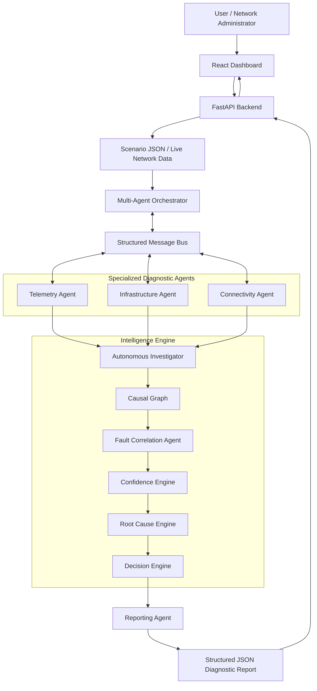
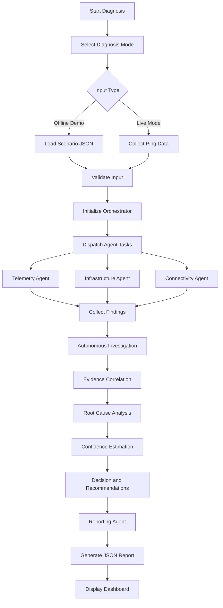

# NetCoop-AI
### Multi-Agent Intelligent Network Fault Diagnosis System

**Collaborative Intelligence for Smarter Network Diagnosis**

NetCoop-AI is a multi-agent network fault diagnosis platform that identifies potential network problems by analyzing network telemetry, infrastructure health, and connectivity information.

The system uses five specialized agents coordinated by a central orchestrator. An autonomous investigation engine and fault correlation mechanism analyze evidence, identify likely root causes, estimate confidence, and generate explainable diagnostic reports with alternative causes and recommended corrective actions.

NetCoop-AI provides a React-based dashboard powered by a Python FastAPI backend. It supports both scenario-based offline diagnosis and basic live network diagnosis.

---

## Key Features

- **Multi-Agent Architecture:** Five specialized agents collaborate to investigate network faults.
- **Autonomous Investigation:** Coordinates investigation and analyzes diagnostic findings.
- **Structured Communication:** Agents exchange information through a custom JSON message protocol.
- **Network Telemetry Analysis:** Examines latency, jitter, packet loss, and link utilization.
- **Infrastructure Analysis:** Evaluates device status, CPU, memory, interface errors, and queue drops.
- **Connectivity Analysis:** Investigates Wi-Fi, DNS, and DHCP-related issues.
- **Fault Correlation:** Combines evidence to identify likely root causes.
- **Confidence Scoring:** Provides heuristic confidence estimates.
- **Causal Analysis:** Uses causal relationships to support diagnosis.
- **Explainable Reports:** Displays evidence, affected components, alternative causes, and recommendations.
- **Interactive Dashboard:** Provides diagnosis, evidence, agent communication, and JSON views.
- **Offline Demo Mode:** Runs predefined network failure scenarios without requiring internet access.
- **Live Diagnosis Mode:** Performs basic ping-based network diagnosis.

---

## System Architecture



### Architecture Components

| Component | Responsibility |
|---|---|
| React Frontend | User interaction and visualization of diagnosis results |
| FastAPI Backend | REST API and frontend/backend integration |
| Orchestrator | Coordinates agents and manages the diagnostic workflow |
| Message Bus | Handles structured communication between agents |
| Autonomous Investigator | Coordinates investigation and evaluates findings |
| Causal Graph | Represents relationships between possible network faults and evidence |
| Confidence Engine | Calculates heuristic confidence scores |
| Root Cause Engine | Supports root cause identification |
| Decision Engine | Helps determine the next diagnostic decision |
| Reporting Agent | Produces the final diagnostic report |

---

## Specialized AI Agents

NetCoop-AI uses five specialized agents.

| Agent | Responsibility |
|---|---|
| Telemetry Agent | Analyzes network performance metrics such as latency, jitter, packet loss, and utilization. |
| Infrastructure Agent | Examines device health, CPU, memory, interface errors, and queue drops. |
| Connectivity Agent | Investigates Wi-Fi signal strength, retransmission, DNS, and DHCP issues. |
| Fault Correlation Agent | Correlates findings and identifies likely network root causes. |
| Reporting Agent | Generates structured diagnostic reports and recommended actions. |

The agents are coordinated by the central orchestrator and supported by the autonomous investigation and intelligence modules.

### Agent Communication Protocol

Agents communicate using a custom structured JSON message protocol.

Messages contain fields such as:

- `sender`
- `recipient`
- `msg_type`
- `incident_id`
- `payload`
- `confidence`
- `units`
- `msg_id`
- `timestamp`

Supported message types:

| Message Type | Purpose |
|---|---|
| REQUEST | Requests diagnostic analysis |
| FINDING | Shares diagnostic findings |
| ERROR | Reports processing or input errors |
| RESULT | Shares diagnostic results |

Implementation:
- Message schema: `backend/core/schema.py`
- Message bus: `backend/core/message_bus.py`

---

## Diagnostic Workflow



### Step-by-Step Process

1. The user selects Offline Demo Mode or Live Investigation Mode.
2. The frontend sends a request to the FastAPI backend.
3. The backend validates the input and initializes the orchestrator.
4. The orchestrator coordinates the specialized diagnostic agents.
5. Agents analyze their respective network information and share findings through the message bus.
6. The Autonomous Investigator coordinates the investigation and evaluates the collected findings.
7. The intelligence modules support evidence correlation, causal analysis, root cause identification, and confidence estimation.
8. The Reporting Agent generates the final structured diagnostic report.
9. The frontend displays the diagnosis, supporting evidence, recommendations, and agent communication history.

---

## Supported Diagnostic Scenarios

The project includes seven predefined scenarios:

| Scenario | Description | Expected Diagnosis |
|---|---|---|
| `normal.json` | Healthy network conditions | No significant anomaly |
| `link_congestion.json` | High link utilization and queue drops | Link congestion |
| `weak_wifi.json` | Weak wireless signal | Wi-Fi connectivity issue |
| `ethernet_fault.json` | Ethernet/interface-related errors | Interface fault |
| `dns_failure.json` | DNS resolution problem | DNS failure |
| `dhcp_failure.json` | DHCP address assignment problem | DHCP failure |
| `malformed.json` | Incomplete or malformed evidence | Insufficient evidence |

The system also validates invalid scenario inputs and handles insufficient diagnostic evidence rather than always claiming a definite root cause.

---

## Root Cause Analysis

The fault correlation mechanism evaluates diagnostic findings using predefined anomaly rules.

| Observed Anomaly | Possible Root Cause |
|---|---|
| High link utilization | Link congestion |
| Queue drops | Egress queue congestion |
| Packet loss | Network instability |
| High latency | Network congestion or connectivity issue |
| High jitter | Network instability |
| Weak Wi-Fi signal | Poor wireless connectivity |
| High retransmission rate | Wireless retransmission issue |
| Interface errors | Ethernet/interface fault |
| Device unavailable | Device failure or unreachable device |
| DNS resolution failure | DNS configuration or resolver issue |
| DHCP assignment failure | DHCP service or configuration issue |

### Confidence Scoring

The system calculates a heuristic confidence score based on the relative scores of competing root cause candidates.

**Important:** Confidence scores are heuristic estimates, not statistically calibrated probabilities.

When evidence is incomplete or insufficient, the system can return an `insufficient_evidence` status.

---

## Frontend Dashboard

The React dashboard provides an interface for running and inspecting network diagnoses.

### Dashboard Features

1. **Network Dashboard:** Displays the system interface and agent pipeline.
2. **Offline Demo Mode:** Selects predefined network failure scenarios.
3. **Live Investigation Mode:** Runs basic ping-based diagnosis.
4. **Diagnosis View:** Displays suspected root cause, status, incident ID, and confidence.
5. **Affected Components:** Shows devices or components identified by the investigation.
6. **Recommended Actions:** Displays troubleshooting recommendations.
7. **Agent Communication:** Shows structured messages exchanged between agents.
8. **Evidence View:** Displays supporting findings and observed metrics.
9. **JSON Report:** Displays and downloads the diagnostic report.

### Frontend Technology Stack

| Technology | Purpose |
|---|---|
| React 19 | User interface |
| Vite | Development and build tool |
| JavaScript | Application logic |
| Axios | HTTP communication |
| Lucide React | Icons |
| CSS | Dashboard styling |

---

## Backend Technology Stack

| Technology | Purpose |
|---|---|
| Python | Backend development |
| FastAPI | REST API framework |
| Pydantic | Data validation |
| Uvicorn | ASGI server |
| JSON | Scenario and report data |
| Custom Message Bus | Agent communication |
| Pytest | Automated testing |

---

## Project Structure

```text
NetCoop-AI/
│
├── frontend/
│   ├── public/
│   ├── src/
│   │   ├── assets/
│   │   ├── components/
│   │   ├── pages/
│   │   ├── App.jsx
│   │   ├── App.css
│   │   ├── index.css
│   │   └── main.jsx
│   ├── package.json
│   ├── package-lock.json
│   └── vite.config.js
│
├── backend/
│   ├── agents/
│   │   ├── base_agent.py
│   │   ├── telemetry_agent.py
│   │   ├── infrastructure_agent.py
│   │   ├── connectivity_agent.py
│   │   ├── fault_correlation_agent.py
│   │   └── reporting_agent.py
│   │
│   ├── intelligence/
│   │   ├── autonomous_investigator.py
│   │   ├── causal_graph.py
│   │   ├── confidence_engine.py
│   │   ├── decision_engine.py
│   │   ├── root_cause_engine.py
│   │   └── telemetry_normalizer.py
│   │
│   ├── diagnostics/
│   │   ├── bandwidth_test.py
│   │   ├── diagnostic_runner.py
│   │   ├── dns_test.py
│   │   ├── interface_test.py
│   │   ├── latency_test.py
│   │   ├── packet_loss_test.py
│   │   └── ping_test.py
│   │
│   ├── remediation/
│   │   ├── action_planner.py
│   │   ├── approval_manager.py
│   │   ├── remediation_executor.py
│   │   └── rollback_manager.py
│   │
│   ├── learning/
│   │   ├── incident_memory.py
│   │   ├── pattern_detector.py
│   │   └── recommendation_engine.py
│   │
│   ├── core/
│   │   ├── message_bus.py
│   │   ├── orchestrator.py
│   │   └── schema.py
│   │
│   ├── data/
│   │   └── scenarios/
│   │       ├── normal.json
│   │       ├── link_congestion.json
│   │       ├── weak_wifi.json
│   │       ├── ethernet_fault.json
│   │       ├── dns_failure.json
│   │       ├── dhcp_failure.json
│   │       └── malformed.json
│   │
│   ├── tests/
│   │   ├── test_intelligence.py
│   │   └── test_orchestrator.py
│   │
│   ├── api.py
│   ├── config.py
│   ├── main.py
│   ├── real_collector.py
│   └── requirements.txt
│
├── offline_bundle/
│   └── wheels/
│
├── START_NETCOOP.bat
├── .gitignore
└── README.md
```

---

## Installation and Setup

### Prerequisites

- Python 3.10 or later
- Node.js and npm
- Git

### 1. Clone the Repository

```bash
git clone https://github.com/Mohid223/NetCoop-AI.git
cd NetCoop-AI
```

### 2. Backend Setup

Create a virtual environment:

```bash
python -m venv .venv
```

Activate it on Windows PowerShell:

```powershell
.\.venv\Scripts\Activate.ps1
```

Install backend dependencies:

```bash
python -m pip install -r backend/requirements.txt
```

Start the backend from the project root:

```bash
python -m uvicorn backend.api:app --reload
```

Backend URL:

`http://127.0.0.1:8000`

Interactive API documentation:

`http://127.0.0.1:8000/docs`

### 3. Frontend Setup

Open a second terminal:

```bash
cd frontend
npm install
npm run dev
```

Frontend development URL:

`http://localhost:5173`

Keep both development servers running while using the application.

---

## API Endpoints

| Method | Endpoint | Description |
|---|---|---|
| GET | `/api/health` | Checks backend availability |
| GET | `/api/scenarios` | Lists available scenarios |
| POST | `/api/run` | Runs scenario-based diagnosis |
| POST | `/api/run-live` | Runs live ping-based diagnosis |

### Health Check

```http
GET /api/health
```

Example response:

```json
{
  "status": "ok",
  "service": "NetCoop AI"
}
```

### List Scenarios

```http
GET /api/scenarios
```

### Run Scenario Diagnosis

```http
POST /api/run
Content-Type: application/json
```

Request:

```json
{
  "scenario_file": "link_congestion.json"
}
```

The scenario file must exist inside:

`backend/data/scenarios/`

### Run Live Diagnosis

```http
POST /api/run-live
```

The current API uses `8.8.8.8` as its default ping target.

---

## Live Network Diagnosis

The live collector is implemented in:

`backend/real_collector.py`

The current live diagnosis workflow uses operating-system ping functionality to collect basic network connectivity information, such as:

- Network reachability
- Average latency
- Packet loss

The collected information is passed into the diagnostic workflow.

**Current limitation:** This is a basic ping-based implementation, not complete real-time campus network monitoring. Direct router, switch, and access-point monitoring through SNMP or equivalent infrastructure integrations is not currently implemented. Metrics not directly collected should not be interpreted as verified live measurements.

---

## Offline Deployment

NetCoop-AI supports local deployment through a production frontend build served by the FastAPI backend.

### Build the Frontend

From the project root:

```powershell
cd frontend
npm install
npm run build
cd ..
```

This generates the production frontend files in:

`frontend/dist/`

### Start the Application

Run:

```powershell
python -m uvicorn backend.api:app --host 127.0.0.1 --port 8000
```

Open:

`http://127.0.0.1:8000`

The backend serves the production frontend when the `frontend/dist` directory is present and mounted.

### Offline Python Dependencies

The project includes an offline wheel bundle under:

`offline_bundle/wheels/`

On a compatible Windows Python environment, dependencies can be installed without internet access:

```powershell
python -m pip install --no-index --find-links=offline_bundle/wheels -r backend/requirements.txt
```

**Compatibility note:** The supplied wheel files are platform- and Python-version-specific. The current bundle was prepared for Windows x64 with CPython 3.13. Other operating systems or Python versions may require a separate wheel bundle.

The frontend build must also be generated before offline deployment if it is not already included.

---

## Testing

The backend uses Pytest for automated testing.

Run the orchestrator tests:

```bash
python -m pytest backend/tests/test_orchestrator.py -v
```

Run the intelligence tests:

```bash
python -m pytest backend/tests/test_intelligence.py -v
```

Run all backend tests:

```bash
python -m pytest backend/tests/ -v
```

The orchestrator test suite has previously passed with **9 tests**. Run the commands above to verify the latest code version.

---

## Current Implementation Notes and Limitations

- Agent communication currently uses a custom in-memory message bus.
- Fault correlation uses predefined rules and heuristic scoring.
- Confidence scores are not calibrated probabilities.
- Live diagnosis currently focuses on ping-based connectivity.
- Direct SNMP-based infrastructure monitoring is not implemented.
- The frontend agent pipeline visualization is a presentation of workflow progress, not a live streaming event feed.
- Remediation recommendations are generated for troubleshooting. Do not assume that every recommendation is automatically executed on real network devices.
- The offline dependency bundle is specific to its prepared platform and Python version.

---

## Future Enhancements

- SNMP integration for direct router and switch monitoring.
- More advanced network telemetry collection.
- Improved agent failure recovery and orchestration.
- Persistent incident history and learning.
- Advanced causal reasoning and evidence validation.
- More network failure scenarios.
- Real-time agent event streaming.
- Safer automated remediation with approval and rollback.
- Broader cross-platform offline deployment support.

---

## Purpose and Impact

NetCoop-AI demonstrates how multiple specialized agents can collaborate to investigate network faults, correlate evidence, and produce explainable diagnostic results.

Instead of relying on a single diagnostic component, the system combines multiple perspectives to help network administrators understand potential failures, identify affected components, evaluate uncertainty, and choose appropriate corrective actions.

**NetCoop-AI — Diagnose. Analyze. Resolve.**

---

## Repository

**GitHub:** https://github.com/Mohid223/NetCoop-AI

